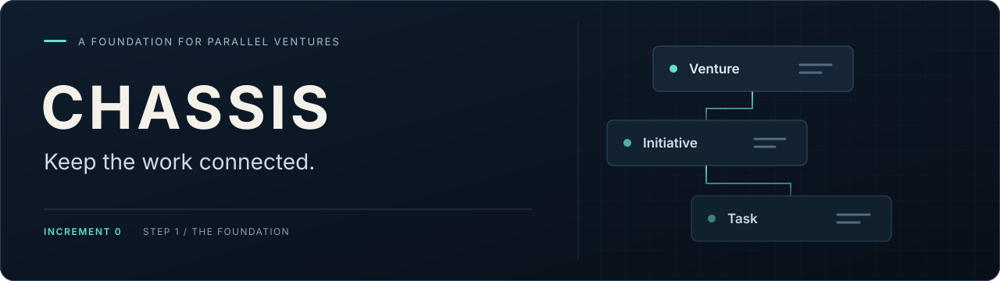

# The work, connected

**Sample vault · Two ventures · Three initiatives · Eight tasks**

Start with a venture, follow an initiative, and open a task for its current status,
owner, and next step. This page provides navigation; the records hold current state.

> All names, ventures, plans, and owners below are fictional demonstration data.

## Ridgeview HOA

[Open the venture](records/ventures/venture-ridgeview.md)

| Initiative | Tasks |
| :--- | :--- |
| [Shared-space maintenance](records/initiatives/initiative-maintenance.md) | [Inventory](records/tasks/task-maintenance-inventory.md) · [Estimates](records/tasks/task-maintenance-quotes.md) · [Decision brief](records/tasks/task-maintenance-plan.md) |
| [Resident updates](records/initiatives/initiative-resident-updates.md) | [FAQ](records/tasks/task-resident-faq.md) · [Monthly bulletin](records/tasks/task-resident-bulletin.md) |

The maintenance work has two dependencies: inventory before estimates, then
estimates before the decision brief. Both are stored as record IDs.

## Acme D2C

[Open the venture](records/ventures/venture-acme.md)

| Initiative | Public sample tasks |
| :--- | :--- |
| [First desk-accessory launch](records/initiatives/initiative-d2c-launch.md) | [Audience interviews](records/tasks/task-audience-interviews.md) · [Starter-kit offer](records/tasks/task-launch-offer.md) |

One additional fictional Acme task is marked restricted in the source vault.
It is reserved for testing exclusion from the future canvas.

## Working with the vault

- Run `uv run chassis validate` to check every record and relationship.
- Open individual records to inspect YAML properties and the Markdown narrative.
- Preserve record IDs and filenames when editing. Read the [architecture](docs/ARCHITECTURE.md).
- Follow the [README](README.md) for setup and the current implementation boundary.
- Check [acceptance evidence](evidence/acceptance.md) for verified and pending work.
