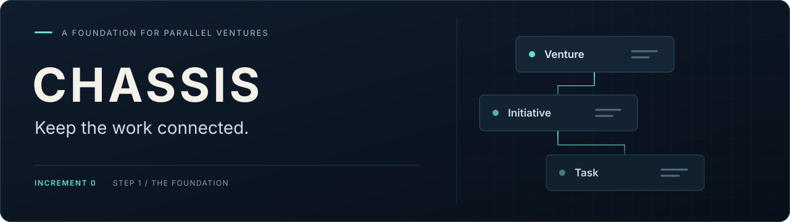

<p align="center">
  
</p>

<p align="center">
  <strong>One place to understand the work. One foundation for moving it forward.</strong>
</p>

<p align="center">
  <a href="#start-here">Start here</a> ·
  <a href="#what-works-today">Current build</a> ·
  <a href="docs/ARCHITECTURE.md">Architecture</a> ·
  <a href="evidence/acceptance.md">Acceptance evidence</a>
</p>

Chassis is Andy Patterson’s command foundation for running parallel ventures.
Its goal is a shared project state that a chief-of-staff agent can read and update,
with a spatial view that makes the next action easy to see.

## Step 6 access requirements

Record reads and writes require an existing policy agent and a valid
`CHASSIS_AGENT_TOKEN`. The local operator provisions a credential with
`uv run chassis agent-token create reviewer`; that command prints the new token
once and stores only its SHA-256 digest in ignored `.chassis/agent-tokens.yaml`.
Export the returned value as `CHASSIS_AGENT_TOKEN` and set `CHASSIS_AGENT_ID` to
the same agent. Repeating the command rotates that agent's credential.
`docs/agent-tokens.example.yaml` contains placeholders only.

Unknown or empty callers, missing/wrong tokens, and revoked access get no records.
Read/write grants are exact per venture and record type. `clearance` defaults to
`normal`; restricted records additionally require `restricted` clearance. They
are completely omitted for other callers, including dependency IDs, graph nodes,
counts, and descendants of hidden parents. Missing and unauthorized reads share
one `not_found` response. No portal masking layer is needed.

Each library read and write appends body-free metadata to ignored
`.chassis/audit.jsonl`. Audit failure withholds read results; a failure after a
successful commit preserves the commit/version recovery facts. `commit-human`
also requires the configured agent's credential and grant, while retaining human
Git attribution. Token provisioning is a local operator command, never an MCP tool.

MCP is optional: `uv sync --extra mcp`. Without the extra, the core remains usable
and `chassis-mcp` explains how to install it. The default request cap is 1 MiB;
set `CHASSIS_MCP_MAX_REQUEST_BYTES` or `--max-request-bytes` to change it.
Malformed JSON returns `-32700`; oversized input is drained and rejected with a
structured error. SIGTERM finishes an active transaction and releases its lock.

These controls govern Chassis APIs. Files and Git history are still plaintext,
and anyone with direct filesystem access can read them. Real data, hosted access,
and agent-to-agent channels remain outside this sample-only increment.

**This checkout delivers Steps 1–6: the library, authenticated MCP, and the P1–P4 read-only portal backend.**
All venture data is fictional. SQLite is a disposable index of working-tree files.
Six MCP tools run over stdio. The approved frontend port, P5–P8, is next.

**Continuing in a new chat?** Read the [project handoff](CHASSIS_PROJECT_HANDOFF.md)
and [project chat setup](docs/PROJECT_CHAT_SETUP.md). Engineering agents should
start with [AGENTS.md](AGENTS.md).

## Start here

Prerequisites: **Python 3.12+, Git, uv, and a POSIX environment**. Step 6 was verified
on Linux; native Windows locking is not implemented. No runtime API key is needed.

```bash
git clone https://github.com/jderomanis1/chassis.git
cd chassis
uv sync --locked
uv run pytest -q
export CHASSIS_AGENT_ID=reviewer
export CHASSIS_AGENT_TOKEN="$(uv run --locked chassis agent-token create "$CHASSIS_AGENT_ID")"
uv run chassis validate
uv run chassis index rebuild
uv run chassis list --venture venture-ridgeview --status blocked
uv run chassis get task-launch-offer
uv run chassis search "three most repeated"
```

Already have a checkout? Start with `uv sync --locked` from its root.
Validation reports the caller's visible records in the working tree. The sample
reviewer sees 12 records; the restricted-clearance chief-of-staff sees 13.
Run `uv sync --locked --all-extras` followed by `.venv/bin/pytest -q` for the full
MCP and portal suite. Without extras, their integration modules are skipped.

Read commands return stable JSON with every record field plus `body` and derived `last_activity_at`. Results
are ordered by ID and include `sensitivity`. The library enforces token identity,
grants, clearance, and hidden relationships before returning any record.
Use `--vault /path/to/chassis` on any
new read/index command to select a vault; `validate` retains its positional path.

List filters are exact matches combined with AND: `--type`, `--venture`,
`--status`, `--parent`, `--assigned-agent`, `--sensitivity`, `--next-milestone`,
`--milestone-due-at`, `--due-at`, `--blocker-reason`, and `--last-activity-at`.
Use `null` for any optional filter, including no parent or an unassigned agent.
Date filters take `YYYY-MM-DD`; activity filters match the returned UTC timestamp exactly.
Search matches a literal, case-insensitive
substring in title, next step, or body; an empty query returns an empty list.
A missing ID returns exit code 1; a list/search with no matches returns `[]`.

Reads detect changed, added, and removed working-tree records automatically.
Deleting `.chassis/index.sqlite` is safe: the next read rebuilds it. Damaged
caches also rebuild. Public source-validation failures use a generic message so
a hidden filename or body cannot escape through an error.
See the [read contract](docs/ARCHITECTURE.md#disposable-index-and-read-contract).

### Write a fictional record

Writes require a configured caller with an exact venture/type grant in `agents.yaml`.
Use a local checkout of the sample vault and set the author identity explicitly:

```bash
export CHASSIS_AGENT_ID=chief-of-staff
export CHASSIS_AGENT_TOKEN="$(uv run --locked chassis agent-token create "$CHASSIS_AGENT_ID")"
export CHASSIS_AGENT_NAME="Fictional Homer"
export CHASSIS_AGENT_EMAIL=homer@chassis.local
uv run chassis get task-launch-budget
uv run chassis update task-launch-budget --expected-version 1 --changes '{"status":"blocked","blocker_reason":"Waiting for fictional review"}'
uv run chassis create task --fields '{"id":"task-fictional-review","title":"Review the fictional launch","status":"planned","owner":"Example Owner","venture":"venture-acme","parent":"initiative-d2c-launch","next_step":"Review the sample plan","body":"Fictional sample only.\n"}'
```

Use the version returned by `get`. Successful writes return the complete record
and commit SHA, commit only that file as the agent, and refresh the index. A stale
write returns exit 3 and a JSON conflict with `current_version`, without changing
the record or history. Version and timestamp are generated; callers cannot change
ID, version, or timestamp on updates. New venture scopes require human provisioning.

Manual edits block agent writes with the filename and `uncommitted human edit`.
Commit an explicitly selected manual edit with the human identity, then reread it:

```bash
export CHASSIS_HUMAN_NAME="Fictional Human"
export CHASSIS_HUMAN_EMAIL=human@chassis.local
uv run chassis commit-human records/tasks/task-launch-budget.md
uv run chassis get task-launch-budget
```

`commit-human` validates and commits the manual bytes, including their version,
without rewriting them. It cannot commit `agents.yaml` or other nonrecord files.
All three commands accept `--vault`. Library callers use the same methods on
`chassis.store.RecordStore(Path(...))`; MCP uses these same methods.
See [write behavior and recovery limits](docs/ARCHITECTURE.md#c6-writes-human-edits-and-the-index).

### Create from a template

With the fictional caller identity above, run:

```bash
uv run chassis new initiative --venture venture-acme --fields '{
  "id": "initiative-sample-launch",
  "title": "Fictional desk-kit pilot",
  "owner": "Avery Quinn",
  "next_step": "Review the fictional launch plan.",
  "sections": {
    "Positioning": "A compact kit for a small desk.",
    "Audience": "Fictional remote workers with small desks.",
    "Channels": "A draft product page and an opt-in sample email.",
    "Offer": "One illustrative starter kit.",
    "Launch checklist": "- [ ] Review ten fictional interviews.",
    "Success metrics": "Sample target: three expressions of interest."
  }
}'
```

The six case-sensitive section names and their order are fixed in `GTM_SECTIONS`.
Every section needs content. Missing values, blanks, markup-only lists, unresolved
`{{...}}`/`${...}` tokens, TODO/TBD/TBC/FIXME/XXX/PLACEHOLDER markers, and insert/replace/fill
markers in brackets are refused. An edited template must retain its headings,
order, and each section's own placeholder. Matching uses Unicode NFKC normalization
to detect compatibility forms such as fullwidth letters. Accepted prose is preserved.
Caller owner, sensitivity, and assignment are checked against the record constraints
before expansion, then revalidated through the shared create transaction.
Expansion does not evaluate code.

`RecordStore(root).create_from_template(template, venture, fields, agent)` is the
same library entry point used by `chassis new`. Both delegate to `create_record`:
exact grant check, lock, validation, generated version/time, one record-only Git
commit, and index refresh. `status` defaults to `planned`; type, venture, parent,
and body are controlled by the template call. `--vault` selects another vault,
which must also contain the two files in `templates/`.

`chassis new agent` takes the same record fields with `sections` named `Playbooks`,
`Channels`, and `Data scope`. It adds the fixed read-only `Permissions` section.
The result is a descriptive file at `records/agents/<id>.md`, parented to its
venture. It neither spawns nor registers an agent and never changes `agents.yaml`.
Its ID has no access until a human configures grants and provisions a token.

Authoring an agent document is itself scoped: a human must add `agent: write`
under the existing author's venture policy. The sample policy contains no such
grant. This permits document creation, not writes by the new
document's ID. `assigned_agent` continues to require a known policy agent ID.

### Approved portal data fields

| Records | Optional fields | Rule |
| :--- | :--- | :--- |
| Ventures and initiatives | `next_milestone`, `milestone_due_at` | Milestone text and an ISO date, `YYYY-MM-DD` |
| Tasks | `due_at`, `blocker_reason` | ISO due date; a blocked task requires a nonempty reason; other statuses require an empty/null reason |
| All read results | `last_activity_at` | Derived from the latest commit touching the record on the current HEAD's history, using UTC committer time |

Omitted optional fields remain valid on older records. A legacy blocked task needs
a reason under the new invariant; the fictional Ridgeview task has been migrated.
To unblock a task, clear `blocker_reason` in the same update. Dates reject timestamps
and numeric coercion. `last_activity_at` is never written into frontmatter. It is
null for records with no commit history, and uncommitted edits do not advance it.
The index recomputes activity even when source bytes and mtime have not changed.
The portal calculates health from these fields and only the viewer's visible
children. The pure rules use an injected Phoenix date and 3/7/14-day thresholds.

### Run the read-only portal backend

```bash
uv sync --locked --extra portal
export CHASSIS_PORTAL_VIEWER_AGENT=reviewer
export CHASSIS_AGENT_TOKEN="$(uv run --locked --extra portal chassis agent-token create "$CHASSIS_PORTAL_VIEWER_AGENT")"
uv run --locked --extra portal chassis portal --port 8765
```

This provisions or rotates the sample viewer token. The server binds to
`127.0.0.1:8765`. A non-loopback host is refused unless
`CHASSIS_PORTAL_ALLOW_REMOTE=1`; remote operation is outside this increment.
The viewer is configured on the server, never selected by a request. Invalid
credentials prevent startup, and token/grant revocation applies to later reads.

| GET endpoint | Response |
| :--- | :--- |
| `/api/version` | `{etag}`: Git HEAD plus a hash of nonignored working-tree files |
| `/api/snapshot` | Venture cards, visible counts, health, and generation time |
| `/api/ventures/{id}` | Venture and its visible initiatives, progress, and GTM sections |
| `/api/initiatives/{id}` | Initiative and its visible tasks |
| `/api/graph?venture=` | Neutral nodes and dependency edges, with health and no layout |
| `/api/search?q=` | Visible hits containing only id, type, and title |

Every endpoint is GET-only, checks Host/Origin, and returns private, nonstored
responses. Errors have `{error:{code,message}}` without stack traces. A missing
and unauthorized record have the same `not_found` response. Empty graph scope
means all visible ventures; a hidden or missing nonempty scope is `not_found`.
There is no frontend or ask endpoint in P1–P4. The unimplemented "Agent writes
today" field is omitted. See the [ADR](docs/PORTAL-ADR.md) for API v1, with Joe's
Step 6 override: complete library-level hiding replaces masked placeholders and
removes hidden children from counts and health.

### Connect an MCP client

Run `uv sync --locked --extra mcp` in the checkout first. The installed entry point
is `.venv/bin/chassis-mcp`; `uv run --locked --extra mcp chassis-mcp --vault
/path/to/sample-vault` also starts it. `python -m chassis.mcp_server` is equivalent
when run with that environment's interpreter.
The process waits for JSON-RPC on stdin. Only protocol messages go to stdout;
logs go to stderr. There is no listening HTTP endpoint.

For Claude Desktop, merge an entry like this into `claude_desktop_config.json`.
Replace every placeholder with local sample-vault configuration. The format follows
the [official MCP client guide](https://modelcontextprotocol.io/docs/develop/connect-local-servers).

```json
{
  "mcpServers": {
    "chassis": {
      "command": "/ABSOLUTE/PATH/TO/chassis/.venv/bin/chassis-mcp",
      "args": ["--vault", "/ABSOLUTE/PATH/TO/FICTIONAL-VAULT"],
      "env": {
        "CHASSIS_AGENT_ID": "CONFIGURED_POLICY_AGENT_ID",
        "CHASSIS_AGENT_TOKEN": "TOKEN_FROM_LOCAL_PROVISIONING",
        "CHASSIS_AGENT_NAME": "CONFIGURED_AGENT_NAME",
        "CHASSIS_AGENT_EMAIL": "agent@example.invalid"
      }
    }
  }
}
```

Restart the client after editing its configuration. `--vault` can instead be set
through `CHASSIS_VAULT`; it defaults to the server's working directory. Caller ID
comes from `CHASSIS_AGENT_ID`, proven by `CHASSIS_AGENT_TOKEN`. Git attribution comes from `CHASSIS_AGENT_NAME`
and `CHASSIS_AGENT_EMAIL`. These are server configuration, never tool arguments.
Missing/unknown identities and missing/wrong tokens get no access. Read-only
callers cannot write. Name/email must be valid before
a permitted write. Record owner and `assigned_agent` are descriptive metadata.

| Tool | Arguments | Successful structured content |
| :--- | :--- | :--- |
| `list_records` | Optional `filters` object using the fields above | `{"records": [...]}` |
| `read_record` | `id` | `{"record": {...}}` |
| `search` | `query` | `{"records": [...]}` |
| `create_record` | `type`, `fields` | `{"record": {...}, "commit": "..."}` |
| `create_from_template` | `template`, `venture`, `fields` | `{"record": {...}, "commit": "..."}` |
| `update_record` | `id`, `changes`, `expected_version` | `{"record": {...}, "commit": "..."}` |

Responses include matching JSON text and MCP `structuredContent`. Tool failures
set `isError: true` and an `error` code: `conflict` includes `current_version`,
`unauthorized` is generic, `dirty_record` retains actionable details, `validation`
has `field` and `reason`, and record `not_found` never echoes a hidden ID. Storage/Git failures
retain their separate recovery codes. If `committed` is true or unknown, inspect
the result and history before retrying. Raw exception/hook diagnostics stay on stderr.

The stable `.chassis/write.lock` inode remains after shutdown so concurrent
waiters share one lock. Successful shutdown releases the kernel lock, leaves no
Git index lock, and ends the server process. Never delete a lock file to unblock it.
The configuration example has not been exercised in the Claude Desktop UI.
Real raw JSON-RPC and official SDK subprocess clients are verified in
[AC2 evidence](evidence/acceptance.md); the recorded wire session is
[mcp-session.jsonl](evidence/mcp-session.jsonl).

**For a visual browse:** open the repository folder as an Obsidian vault and open
[HOME.md](HOME.md). Obsidian is optional; the records are ordinary Markdown.
The actual Obsidian UI check is tracked in the acceptance evidence.

## What works today

| Capability | Current status |
| :--- | :--- |
| One Markdown file per venture, initiative, task, or agent document | Implemented |
| Strict frontmatter schema, including sensitivity and assigned agent | Implemented |
| Relationship and dependency validation | Implemented |
| Local validation command and automated tests | Implemented |
| Fictional sample vault | 2 ventures, 3 initiatives, 8 tasks, 2 dependencies |
| Agent identity and read/write authorization | Verified tokens, exact venture/type grants, deny by default, per-agent clearance |
| Disposable SQLite and list/get/search | Implemented, including automatic refresh and recovery |
| Versioned create/update and human commits | Implemented; process lock, atomic files, record-only Git commits |
| Initiative and read-only agent templates | Implemented; AC4 passes through the library and CLI |
| Milestones, task due dates/blockers, and derived Git activity | Implemented; pure portal health with frozen-clock tables |
| Six official SDK MCP tools over stdio | Implemented; AC2 real-client and concurrent-writer proof |
| Read-only portal backend P1–P4 | Six GET endpoints; library filtering, origin checks, error envelopes, and leak tests |
| Frontend P5–P8, layout, optional Miro, chat import | Subsequent steps |

## Explore the sample

| Venture | Focus | Initiatives | Tasks |
| :--- | :--- | ---: | ---: |
| Ridgeview HOA | Maintenance planning and resident communication | 2 | 5 |
| Acme D2C | Preparing a first product launch | 1 | 3 |

Both sample dependencies belong to Ridgeview HOA, ready for the later Miro proof.
Names, owners, plans, and records are demonstration data.

## Design commitments

- **Files carry the truth.** YAML frontmatter and Markdown stay readable without a service.
- **History stays explicit.** Record writes use version checks and attributed Git commits.
- **Permissions have a home.** `agents.yaml` defines scoped grants; unknown agents have no access.
- **Private work stays private.** Unauthorized restricted records and relationships are absent from library results.
- **The canvas can change.** The neutral graph keeps later layout independent of Miro.
- **Board changes stay precise.** Tracked mappings, fingerprints, and pending creates will protect item identity.

These are the build contracts. See [architecture](docs/ARCHITECTURE.md) for the
implementation boundaries and [acceptance evidence](evidence/acceptance.md) for
what has actually been verified.

## Find your way around

| Path | Purpose |
| :--- | :--- |
| `records/` | Authoritative ventures, initiatives, tasks, and agent documents |
| `agents.yaml` | Agent access policy |
| `templates/` | Constrained initiative and agent Markdown templates |
| `src/chassis/` | Schema, parsing, policy, index, write transactions, and local commands |
| `tests/` | Tests of the implemented behavior |
| `docs/` | Architecture and project presentation |
| `evidence/` | Acceptance status and recorded checks |
| `render/miro/` | Tracked board mappings for the later renderer |
| `.chassis/` | Ignored token hashes, body-free audit log, disposable index, and shared write lock; do not unlink a live lock |

## Next in the build

Step 6 is complete. The next named step is the approved prototype's frontend port,
P5–P8. It must escape record content, include empty/loading/error states, and add
Playwright checks against the prototype. Layout and change planning follow; Miro
is an optional export and chat import is separate. See the handoff's next prompt.

Keep secrets in environment variables. `.env` is ignored; `.env.example`
documents the author identity and later Miro configuration.

---

**Project owner: Andy Patterson.** See [OWNERSHIP.md](OWNERSHIP.md).
